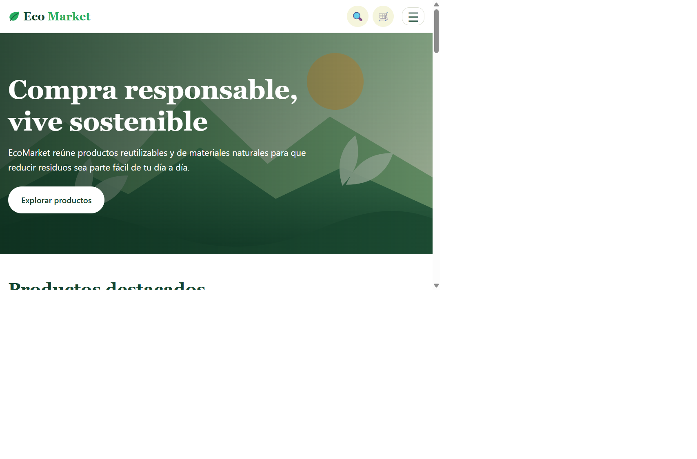
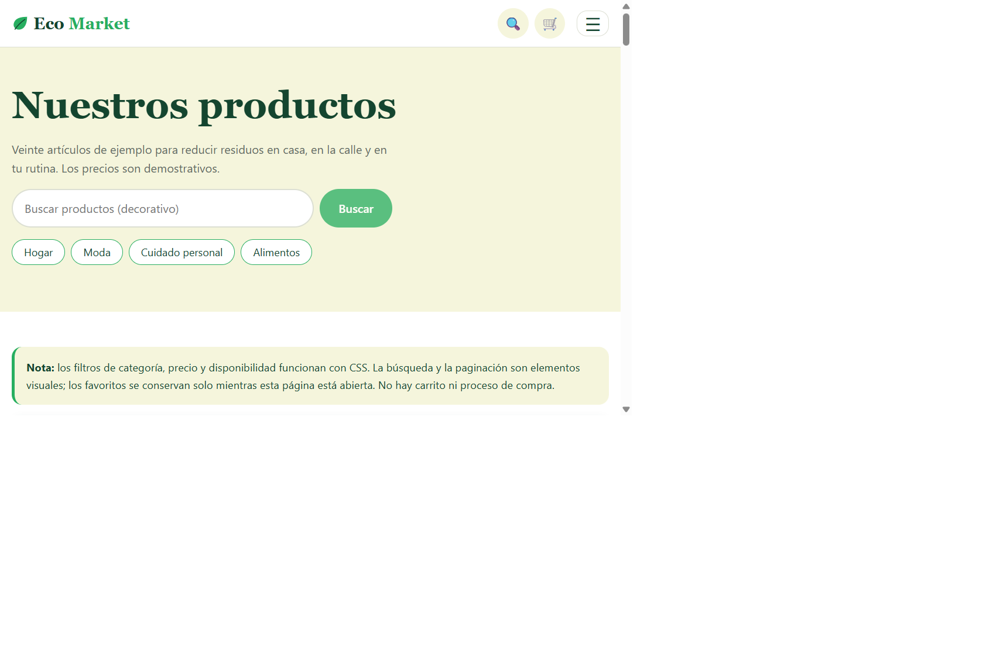
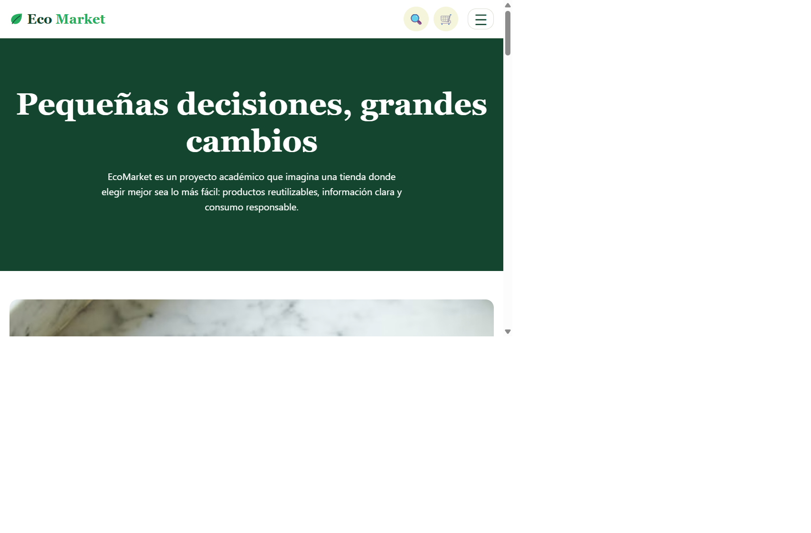
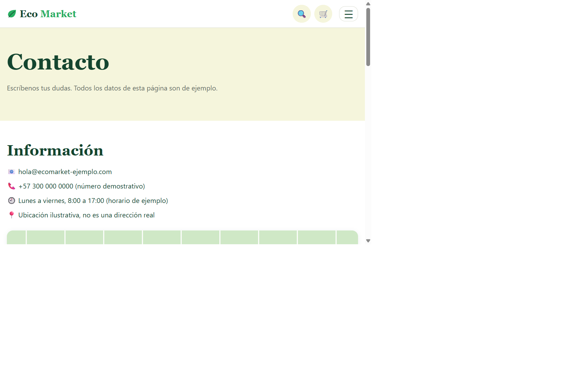
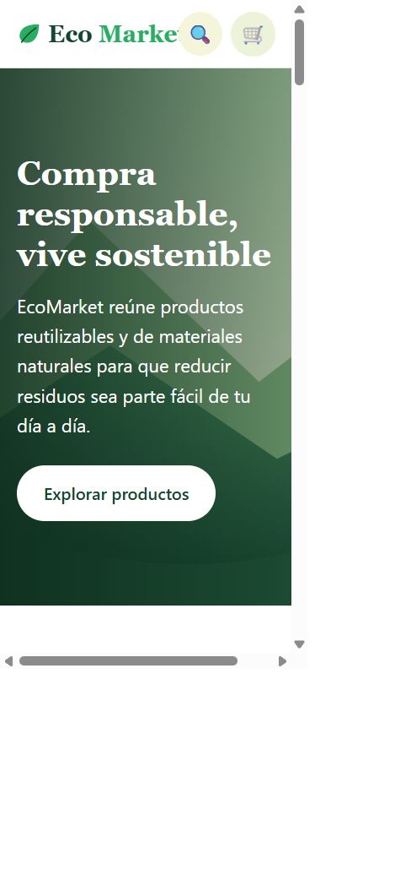
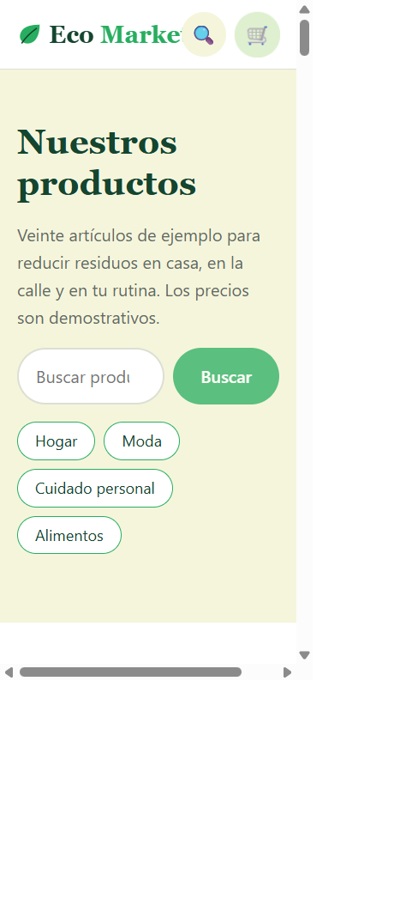
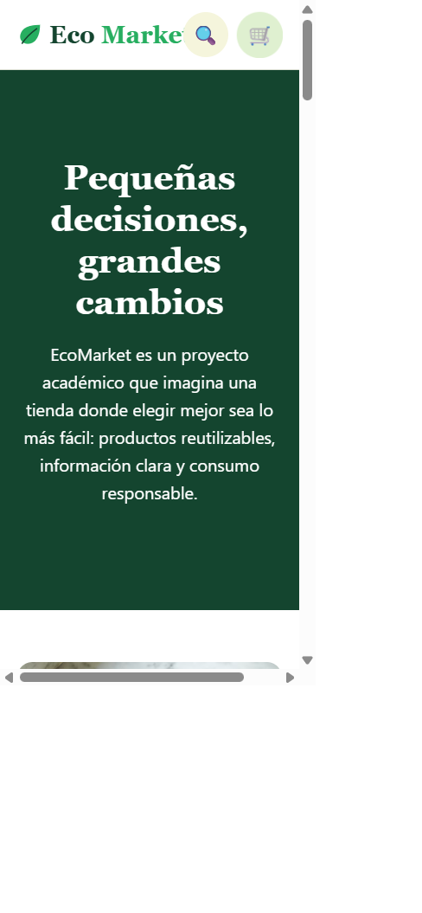
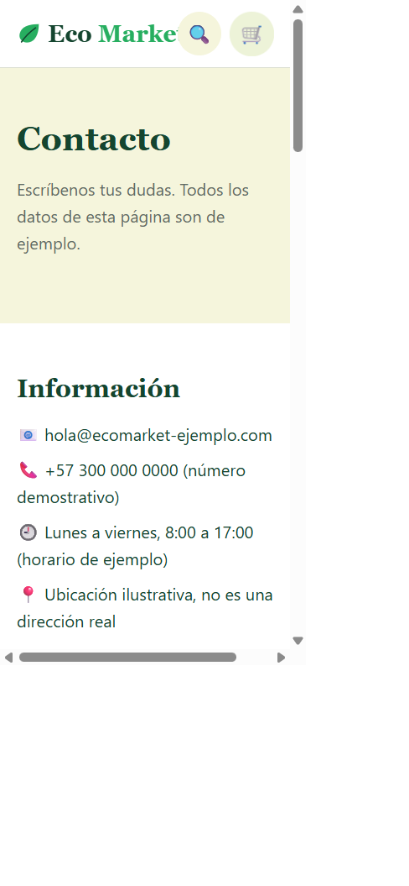

# EcoMarket

Tienda demostrativa de productos ecológicos, reutilizables y sustentables. El proyecto presenta cuatro vistas responsivas y concentra la interactividad en HTML semántico y CSS puro; no utiliza JavaScript ni frameworks.

> Los productos, precios, testimonios y datos de contacto son ilustrativos. No hay carrito, procesamiento de pagos ni envío de mensajes.

## Vistas

- **Inicio:** propuesta de valor, hero, seis productos destacados y beneficios.
- **Productos:** catálogo de 20 artículos, filtros CSS de categoría, precio y disponibilidad, favoritos visuales y paginación de muestra. El buscador es únicamente visual.
- **Nosotros:** historia, misión, principios y testimonios de ejemplo desplazables.
- **Contacto:** formulario con validación nativa y mapa de Google con la ubicación de Amanecer Paisa en Bucaramanga. El formulario no transmite ni almacena datos.

## Tecnologías

- HTML5 semántico y CSS3.
- CSS Grid y Flexbox con enfoque mobile-first.
- Selectores CSS, pseudoestados, transiciones y animaciones con soporte para movimiento reducido.
- Imágenes locales SVG y fotografías de Unsplash.

## Estructura

```text
EcoMarket/
├── css/
│   ├── main.css
│   ├── layout.css
│   ├── components.css
│   └── animations.css
├── img/
│   ├── hero/
│   ├── icons/
│   ├── products/
│   └── screenshots/
├── views/
│   ├── productos.html
│   ├── sobre-nosotros.html
│   └── contacto.html
├── index.html
├── netlify.toml
└── README.md
```

La vista de nosotros se llama `views/sobre-nosotros.html`.

## Visualización local

Abre `index.html` en un navegador o inicia un servidor estático desde la carpeta del proyecto:

```bash
python -m http.server 8000
```

Luego visita <http://localhost:8000>. No es necesario instalar dependencias.

## Capturas

### Escritorio

| Inicio | Productos | Nosotros | Contacto |
|---|---|---|---|
|  |  |  |  |

### Móvil

| Inicio | Productos | Nosotros | Contacto |
|---|---|---|---|
|  |  |  |  |

## Publicación

El sitio es estático y está preparado para Netlify con `netlify.toml`. Importa el repositorio en Netlify y publica la carpeta raíz (`.`), sin comando de compilación. Para GitHub Pages, habilita Pages para la rama publicada y la carpeta raíz.

## Flujo de trabajo Git

Usa ramas de funcionalidad desde `main` (por ejemplo, `feature/catalogo` y `feature/contact-form`) y mensajes de commit Conventional Commits, como `feat: add CSS catalog filters` o `docs: document local setup`.
